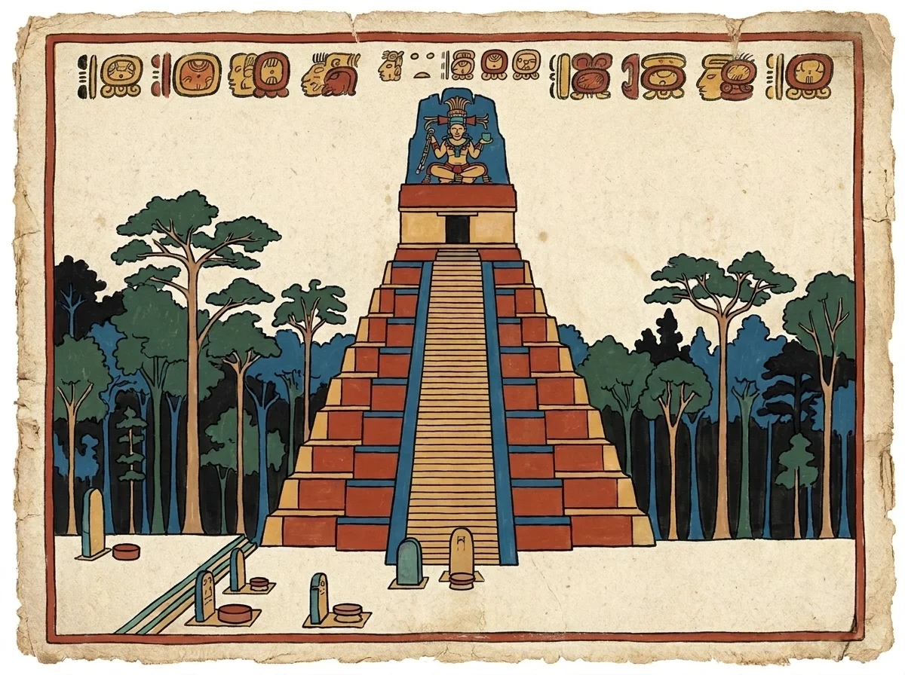

# Billedstil – codex-stil

Alle illustrationer laves i **codex-stil** (stil A i `PLAN.md`), inspireret af mayaernes egne bøger som Dresden-kodeksen.

## Stilark



`content/maya/media/stil/tempel1-codex-stilark.webp` – Tempel I (Den Store Jaguars Tempel) i Tikal. Vedhæftes som **billede 1** til alle nye billeder.

Sådan blev det til (31. oktober 2026, model `gemini-3-pro-image`):

| Version | Fil | Vurdering |
|---|---|---|
| v1 | `tempel1-codex-v1.webp` | Flot barkpapir og glyf-bort, men pyramiden er for bred og lav (ligner Chichén Itzá), og træerne ligner baobab |
| v2 | `tempel1-codex-v2.webp` | Rigtige proportioner (høj, smal, stejl, højt tagkam) og ceiba-træer, men glat papir uden tekstur |
| **v3 – stilark** | `tempel1-codex-stilark.webp` | v1 som stilreference + v2 som kompositionsreference. Bedste fra begge |

Erfaringer:
- Gemini laver pyramider for brede, hvis man ikke skriver proportionerne eksplicit ("about twice as tall as it is wide", "NOT like Chichen Itza").
- Referencebilleder virker godt: modellen holder sig tæt til både stil og komposition.
- Glyfferne er dekorative og **ikke** læsbare mayaskrift. Det skal stå i billedteksten, hvis det er relevant.

## Palet

| Navn | Hex (ca.) | Brug |
|---|---|---|
| Mayablå | `#2E6FA7` | Himmel, vand, accent |
| Rød okker | `#B5432A` | Rammer, bygninger, overskrifter |
| Gul okker | `#D9A441` | Sten, fremhævning |
| Jadegrøn | `#3F7A5A` | Vegetation, jade |
| Sort kontur | `#1C1A17` | Streger, tekst |
| Barkpapir | `#F3E9D2` | Baggrund |

Paletten bruges også som design tokens i `web/src/theme/`.

## Arbejdsgang for et nyt billede

1. Kopiér `tools/billeder/skabelon.txt` og udfyld `[MOTIV]` på engelsk med konkrete detaljer.
2. Kør:
   ```bash
   GEMINI_API_KEY=... python3 tools/billeder/gemini_billede.py min-prompt.txt content/maya/media/<navn>.webp content/maya/media/stil/tempel1-codex-stilark.webp
   ```
   Hvis kompositionen er forkert, så lav en version med ret komposition og send den med som billede 2 (som ved v3).
3. Tjek fakta i billedet (arkitektur, dragter, genstande) mod kilderne for kapitlet.
4. Gem som WebP i `content/maya/media/` og skriv i kapitlets front-matter, at billedet er en **rekonstruktion/illustration**, ikke en rigtig genstand.
